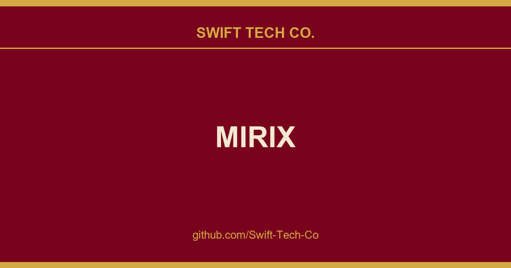

# MIRIX

## What This Is

Every project needs a shelf of ready answers. product and engineering is one of those shelves, and MIRIX is the entry on it - the notes, patterns and fixes we reuse when this kind of work comes up.

## Images

[](https://github.com/Swift-Tech-Co/MIRIX)

## MIRIX - Multi-Agent Personal Assistant with an Advanced Memory System

Your personal AI that builds memory through screen observation and natural conversation

| 🌐 Website | 📚 Documentation | 📄 Paper | 💬 [Telegram](https://t.me/+Qt_eFvkb2rliMzNh)

---

### Key Features 🔥

- **Multi-Agent Memory System:** Six specialized memory components (Core, Episodic, Semantic, Procedural, Resource, Knowledge Vault) managed by dedicated agents
- **Screen Activity Tracking:** Continuous visual data capture and intelligent consolidation into structured memories
- **Privacy-First Design:** All long-term data stored locally with user-controlled privacy settings
- **Advanced Search:** PostgreSQL-native BM25 full-text search with vector similarity support
- **Multi-Modal Input:** Text, images, voice, and screen captures processed seamlessly

### Quick Start
**Step 1: Backend & Dashboard (Docker):**
```
docker compose up -d --pull always
```
- Dashboard: https://github.com/Swift-Tech-Co/MIRIX
- API: https://github.com/Swift-Tech-Co/MIRIX

**Step 2: Create an API key in the dashboard (http://localhost:5173) and set as the environmental variable `MIRIX_API_KEY`.**

**Step 3: Client (Python, `mirix-client`, https://github.com/Swift-Tech-Co/MIRIX):**
```
pip install mirix-client
```

Now you are ready to go! See the example below:
```python
from mirix import MirixClient

client = MirixClient(
    api_key="your-api-key",
    base_url="https://github.com/Swift-Tech-Co/MIRIX",
)

client.initialize_meta_agent(
    config={
        "llm_config": {
            "model": "gemini-2.0-flash",
            "model_endpoint_type": "google_ai",
            "api_key": "your-api-key-here",
            "model_endpoint": "https://github.com/Swift-Tech-Co/MIRIX",
            "context_window": 1_000_000,
        },
        "embedding_config": {
            "embedding_model": "text-embedding-004",
            "embedding_endpoint_type": "google_ai",
            "api_key": "your-api-key-here",
            "embedding_endpoint": "https://github.com/Swift-Tech-Co/MIRIX",
            "embedding_dim": 768,
        },
        "meta_agent_config": {
            "agents": [
                {
                    "core_memory_agent": {
                        "blocks": [
                            {"label": "human", "value": ""},
                            {"label": "persona", "value": "I am a helpful assistant."},
                        ]
                    }
                },
                "resource_memory_agent",
                "semantic_memory_agent",
                "episodic_memory_agent",
                "procedural_memory_agent",
                "knowledge_vault_memory_agent",
            ],
        },
    }
)

client.add(
    user_id="demo-user",
    messages=[
        {"role": "user", "content": [{"type": "text", "text": "The moon now has a president."}]},
        {"role": "assistant", "content": [{"type": "text", "text": "Noted."}]},
    ],
    session_id="sess-demo-001",
)

## License

Mirix is released under the Apache License 2.0. See the [LICENSE](LICENSE) file for more details.

## Contact

## Join Our Community

Connect with other Mirix users, share your thoughts, and get support:

### 💬 Telegram
Telegram for real-time discussions, support, and community updates:
**[https://t.me/+Qt_eFvkb2rliMzNh](https://t.me/+Qt_eFvkb2rliMzNh)**

### 🎯 Weekly Discussion Sessions
We host weekly discussion sessions where you can:
- Discuss issues and bugs
- Share ideas about future directions
- Get general consultations and support
- Connect with the development team and community

**📅 Schedule:** Friday nights, 8-9 PM PST
**🔗 Zoom Link:** https://github.com/Swift-Tech-Co/MIRIX

### 📱 WeChat Group
You can add the account `ari_asm` so that I can add you to the group chat.

---

## Swift Tech Co.

Built and maintained by Swift Tech Co.

AI Automation | FinTech Platforms | Custom Software and Mobile Apps | SaaS Platforms | Cloud Infrastructure | Cybersecurity | SEO and Marketing | API Integration

**Join our community on Telegram:** [t.me/+Qt_eFvkb2rliMzNh](https://t.me/+Qt_eFvkb2rliMzNh)

Home | Services | Careers | Referral Program | Influencers | About | Contact

**Connect**

- Website: https://github.com/Swift-Tech-Co/MIRIX
- LinkedIn: [linkedin.com/in/stephenoladoke](https://www.linkedin.com/in/stephenoladoke/)
- LinkedIn (Company): [linkedin.com/company/swift-tech-co](https://www.linkedin.com/company/swift-tech-co)
- X: [@MrOladoke](https://x.com/MrOladoke)
- Instagram: [@mr.oladoke](https://www.instagram.com/mr.oladoke/)
- Instagram (Company): [@swifttechco](https://www.instagram.com/swifttechco/)
- Organization: [github.com/Swift-Tech-Co](https://github.com/Swift-Tech-Co)

## Sources

Compiled and maintained from upstream [Mirix-AI/MIRIX](https://github.com/Mirix-AI/MIRIX) under permissive open-source license.

---

Maintained by [Swift Tech Co.](https://github.com/Swift-Tech-Co) - [Telegram](https://t.me/+Qt_eFvkb2rliMzNh)

## Sources

Compiled and maintained from upstream [Mirix-AI/MIRIX](https://github.com/Mirix-AI/MIRIX) under permissive open-source license.

---

Maintained by [Swift Tech Co.](https://github.com/Swift-Tech-Co) - [Telegram](https://t.me/+Qt_eFvkb2rliMzNh)

## Sources

Compiled and maintained from upstream [Mirix-AI/MIRIX](https://github.com/Mirix-AI/MIRIX) under permissive open-source license.

---

Maintained by [Swift Tech Co.](https://github.com/Swift-Tech-Co) - [Telegram](https://t.me/+Qt_eFvkb2rliMzNh)